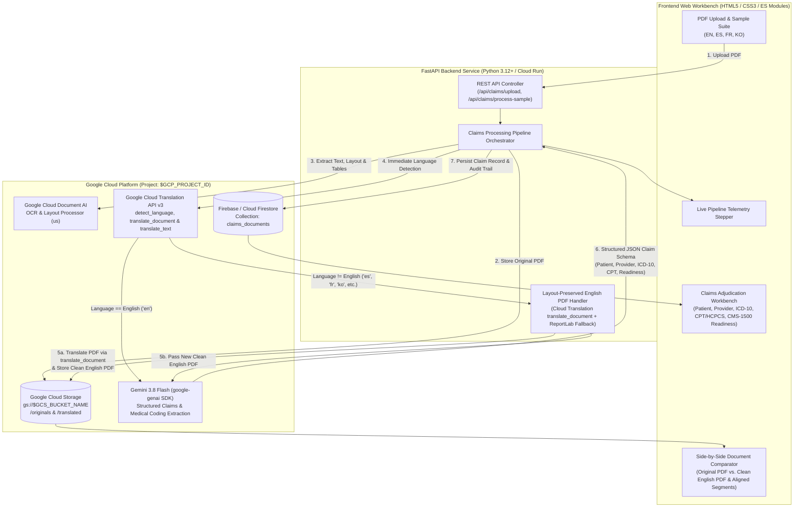
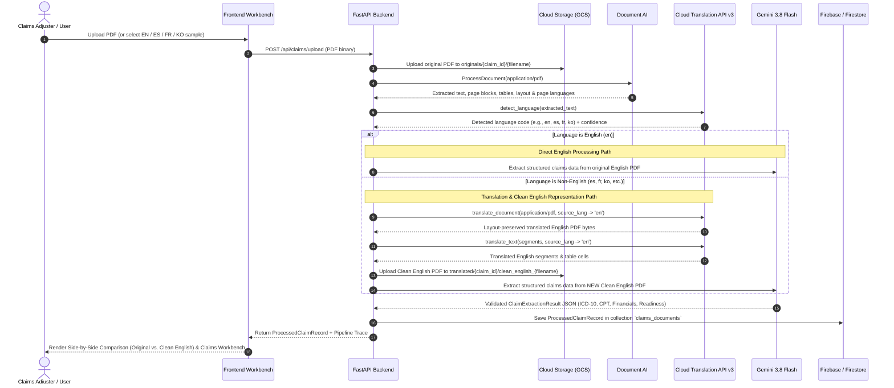

# Healthcare Claims Document Processing & Translation Platform — Architecture & Design Document

**Configuration:** Managed via `.env.gcp` (template: [`.env.gcp.example`](.env.gcp.example), ignored by git)  
**Document Version:** 1.1  
**Status:** Active / Living Design Document  

---

## 1. Executive Summary & Problem Statement

Healthcare claims adjudication teams receive heterogeneous PDF documents from patients, domestic providers, and international medical facilities. These documents include:
- **Itemized Medical Bills** (both **with** standard CPT/HCPCS/ICD-10 coding and **without** coding)
- **Insurance Cards** (front/back subscriber & payer details)
- **Insurance Policy Details & Benefits Summaries**
- **Proof of Payment / Hospital Receipts**
- **Medical Records & Clinical Discharge Summaries**
- **Specialist Referrals**
- **Prior Authorizations**

Furthermore, global health plans and travel/expatriate claims frequently arrive in non-English languages (such as **Spanish**, **French**, and **Korean**). Manual translation and coding review introduce high latency and transcription errors.

This application provides an automated, end-to-end **Healthcare Claims Document Ingestion, Translation, Side-by-Side Comparison, and Structured Extraction Platform** built on Google Cloud (`$GCP_PROJECT_ID`).

---

## 2. High-Level System Architecture



---

## 3. End-to-End Processing Workflow



---

## 4. Architectural Decision Records (ADRs)

### ADR-001: Google Cloud Storage Bucket Design for Sensitive Healthcare Claims Documents
- **Context:** Initial uploaded PDFs and generated clean English PDFs contain sensitive healthcare claim details (patient demographics, clinical diagnoses, billing records).
- **Decision:** Store all raw and translated documents in a dedicated regional Google Cloud Storage bucket `gs://${GCS_BUCKET_NAME}` in `us-central1` configured with Sensitive Data & Compliance controls:
  - **Uniform Bucket-Level Access (UBLA):** Enabled (`--uniform-bucket-level-access`) to eliminate per-object ACL drift and simplify IAM governance.
  - **Public Access Prevention (PAP):** Enforced (`--public-access-prevention=enforced`) to guarantee no claim document can ever be exposed publicly.
  - **Soft Delete Policy:** 7-day retention (`--soft-delete-duration=7d`) to protect against accidental deletion while minimizing retention overhead.
  - **CSEK Restriction:** Customer-Supplied Encryption Keys restricted via `--encryption-enforcement-file` so all objects use Google-managed encryption or CMEK with full auditability.
  - **Object Lifecycle Management:** 7-year retention (`2555` days, aligned with HIPAA medical claim record retention guidelines) plus automatic cleanup of incomplete multipart uploads after 7 days.
  - **Object Namespace Hierarchy:**
    - `originals/{claim_id}/{filename}` — Immutable original uploaded PDF.
    - `translated/{claim_id}/clean_english_{filename}` — Clean English PDF representation generated after Cloud Translation.

### ADR-002: Hybrid Layout & OCR Extraction with Google Cloud Document AI
- **Context:** Healthcare claims arrive as both digital-native PDFs and scanned multi-language documents containing complex tables, medical codes, and stamps.
- **Decision:** Use **Google Cloud Document AI** (`documentai.googleapis.com`, `OCR_PROCESSOR` in `us` multi-region) as the primary document parsing engine to extract text, structural paragraphs/blocks, tables, and page-level language signals. Include an automatic processor provisioning helper and a local `pypdf` extraction fallback so the pipeline remains operational during initial API propagation.

### ADR-003: Immediate Language Detection & Layout-Preserved Document Translation via Google Cloud Translation API v3
- **Context:** The system must immediately verify the language of every incoming document. English documents should bypass translation to minimize latency and cost, whereas non-English documents must be translated into English while preserving the original document layout, tables, and formatting as much as possible.
- **Decision:**
  1. Immediately invoke **Google Cloud Translation API v3** (`TranslationServiceClient.detect_language`) alongside Document AI's `detected_languages` metadata.
  2. **Branch 1 (`language_code == "en"`):** Process the original English PDF directly without calling translation or generating a duplicate PDF.
  3. **Branch 2 (`language_code != "en"`):**
     - Invoke **Google Cloud Translation Advanced (v3) Document Translation (`TranslationServiceClient.translate_document` / `projects.locations.translateDocument`)** passing `DocumentInputConfig(content=pdf_bytes, mime_type="application/pdf")`, `enable_shadow_removal_native_pdf=True`, and `enable_rotation_correction=True` (per [Translate documents](https://docs.cloud.google.com/translate/docs/advanced/translate-documents)).
     - Retrieve the layout-preserved English PDF directly from `response.document_translation.byte_stream_outputs[0]`, which preserves the original PDF's tables, borders, column widths, headers, and styling in-place, and upload it to `gs://${GCS_BUCKET_NAME}/translated/{claim_id}/clean_english_{filename}`.
     - Also translate the extracted structural segments via `translate_text` so the UI supports both **Side-by-Side Layout-Preserved PDF Comparison** and **Side-by-Side Aligned Segment Comparison** (`original_text` ↔ `translated_text`).
     - Pass the **new Clean English Representation** to Gemini for downstream claims extraction.

### ADR-004: Structured Healthcare Claims Extraction & Coding Assistance Using Gemini 3.8 Flash
- **Context:** Claims documents vary widely in structure (itemized bills with codes, itemized bills without codes, insurance cards, policy documents, receipts, medical records, referrals, prior authorizations). Downstream adjudication requires normalized structured JSON and standardized medical codes (ICD-10-CM, CPT, HCPCS).
- **Decision:** Use **Gemini 3.8 Flash** (`gemini-3.8-flash`) via the official `google-genai` SDK (`>= 2.25.0`) with strict JSON Schema structured output (`ClaimExtractionResult`).
  - Pass the English document (the original PDF for English uploads, or the newly generated Clean English PDF + translated text for non-English uploads) to `gemini-3.8-flash`.
  - When a medical bill lacks standardized CPT/HCPCS or ICD-10 codes (common in international hospital bills from Mexico, France, or South Korea), Gemini extracts the line items and provides **AI-Suggested CPT/HCPCS and ICD-10-CM codes** explicitly tagged with `code_source: "AI_SUGGESTED"` vs. `"EXTRACTED"`, enabling rapid medical coder review without conflating inferred codes with source-printed codes.
  - Compute a **Claims Readiness Assessment** (`readiness_status`, `readiness_score`, CMS-1500 field mapping, and missing-field checklist).

### ADR-005: Firebase / Cloud Firestore for Claims Persistence & Audit Trail
- **Context:** Processed claims, translation mappings, pipeline telemetry, and GCS document references must be stored in a scalable backend database accessible to the application.
- **Decision:** Use **Firebase / Cloud Firestore** (`(default)` database in `$GCP_PROJECT_ID`, collection `claims_documents`) via `firebase-admin` and `google-cloud-firestore`. Maintain a synchronized local JSON cache (`data/firestore_cache.json`, gitignored) for instant startup and offline resilience.

### ADR-006: FastAPI + Zero-Build Modern Web Frontend
- **Context:** The application requires a responsive, low-latency UI capable of rendering side-by-side PDFs, translation diff views, and complex claims tables, alongside a Python backend that integrates natively with all Google Cloud SDKs.
- **Decision:** Serve a modern, standards-based HTML5/CSS3/ES-Module frontend directly from the **FastAPI** backend service. This eliminates fragile Node/Webpack build steps, simplifies containerization into a single Cloud Run image, and provides native streaming endpoints for side-by-side PDF comparison.

### ADR-007: Externalized Project Specifics & Secret Protection for Public Repository
- **Context:** When publishing the repository to public GitHub, no project-specific identifiers (`GCP_PROJECT_ID`, `GCP_PROJECT_NUMBER`, `GCS_BUCKET_NAME`, `DOCAI_PROCESSOR_ID`), credentials, or cached claim data should be committed.
- **Decision:** Store all environment-specific configuration in `.env.gcp` and `.firebaserc` (both protected by [`.gitignore`](.gitignore) and [`.dockerignore`](.dockerignore)) and provide tracked templates [`.env.gcp.example`](.env.gcp.example) and [`.firebaserc.example`](.firebaserc.example) with explicit `TODO` markers.

---

## 5. Google Cloud Storage Security Posture & Bucket Plan (`google-cloud-storage-bucket-architect`)

### Phase 1: Project-Level Security Posture Assessment
| Security Setting | Recommended Control |
| :--- | :--- |
| **Enforce TLS (1.2+)** (`constraints/gcp.restrictTLSVersion`) | Restrict TLS 1.0/1.1 via Organization Policy where `orgpolicy.googleapis.com` is available. |
| **Enforce HTTPS-only** (`constraints/storage.secureHttpTransport`) | Enforce HTTPS-only transport via Organization Policy. |
| **Restrict Auth Types (Disable HMAC)** (`constraints/storage.restrictAuthTypes`) | Restrict S3-compatible HMAC keys via Organization Policy. |
| **Project Deletion Lien** (`resourcemanager.liens`) | Apply a project deletion lien on production projects to prevent accidental deletion. |

### Phase 2: Bucket Creation Plan (`gs://${GCS_BUCKET_NAME}`)
- **Use Case:** Sensitive Data & Compliance (Healthcare Claims Documents, Medical Records, Itemized Bills, Insurance Cards)
- **Bucket Name:** `${GCP_PROJECT_ID}-claims-docs` (configured via `GCS_BUCKET_NAME` in `.env.gcp`)
- **Location:** `us-central1` (Regional, co-located with Firestore and Cloud Run)
- **Storage Class:** `STANDARD`
- **Access Control:**
  - Uniform Bucket-Level Access (UBLA): **Enabled** (`--uniform-bucket-level-access`)
  - Public Access Prevention (PAP): **Enforced** (`--public-access-prevention=enforced`)
- **Data Protection:**
  - Soft Delete Retention: **7 days** (`--soft-delete-duration=7d`)
  - Encryption Enforcement: Restrict Customer-Supplied Encryption Keys (`CSEK`) so all objects use Google-managed or KMS encryption.
- **Lifecycle Management:**
  - Rule 1: Delete objects older than `2555` days (~7 years, standard healthcare claims retention period).
  - Rule 2: Abort incomplete multipart uploads after `7` days.
- **Labels:** `env=prod`, `workload=healthcare-claims`, `data-classification=confidential`, `project=${GCP_PROJECT_ID}`

---

## 6. Realistic Multi-Language Test Documents Suite

The repository includes a deterministic generator (`scripts/generate_test_pdfs.py`) that produces four realistic healthcare claims PDF documents in `sample_documents/`, each designed with a **distinct visual layout, color palette, and regional medical document structure** so layout preservation via `translate_document` is clearly visible across formats:

| Test ID | Language | Filename | Visual Format & Layout Style | Document Types Covered | Clinical & Billing Scenario |
| :--- | :--- | :--- | :--- | :--- | :--- |
| `english` | **English (`en`)** | `english_itemized_medical_bill.pdf` | **US CMS-1500 / UB-04 Hospital Statement & Insurance Card (`#7F1D1D` Crimson & Slate):** Split masthead with right-hand statement summary box, side-by-side simulated Aetna Choice POS II Insurance Card & CMS-1500 Box 2/3/5/33 card, Box 21 3-column diagnosis pointer grid, Box 24 CPT/HCPCS ledger, and perforated bottom remittance stub. | Itemized Medical Bill **with Coding** (CPT/HCPCS/ICD-10), Insurance Policy Details, Proof of Copay Payment | **Pacific Northwest Medical Center (Seattle, WA):** Emergency visit & IV antibiotic therapy for Pneumonia (`J18.9`). Coded CPT lines (`99284`, `71046`, `87070`, `80053`, `96365`, `J0696`). Total `\$2,765.00 USD`. Processed directly in English. |
| `spanish` | **Spanish (`es`)** | `spanish_factura_medica_hospital.pdf` | **Mexican CFDI 4.0 Fiscal Electronic Invoice (`#065F46` Emerald & Mint):** Full-width emerald CFDI 4.0 banner header, side-by-side Emisor (RFC/CLUES) and Receptor fiscal cards, bordered emergency clinical box with left emerald accent bar & vitals sidebar, uncoded hospital tariff table, and split SAT CFDI UUID stamp + stacked MXN/USD totals box. | Itemized Medical Bill **without Coding**, Emergency Medical Record, Proof of Payment (`CFDI`) | **Hospital Ángeles Pedregal (Mexico City, Mexico):** Acute non-perforated appendicitis (`Apendicitis aguda`) emergency laparoscopic appendectomy for patient Mateo Rojas. Descriptive Spanish billing lines (`\$56,500.00 MXN`). Translated to English + AI-suggested CPT/ICD-10 codes. |
| `french` | **French (`fr`)** | `french_dossier_medical_autorisation.pdf` | **European Clinical Letterhead, Prior Auth Certificate & MRI Dossier (`#312E81` Royal Indigo):** Centered European hospital letterhead with double indigo rule, framed Prior Authorization Certificate (`PA-FR-2026-90412`) & referral routing block, 2-column narrative Knee MRI report & CIM-10/ICD-10 sidebar, *Feuille de Soins* table, and *Quittance* + practitioner signature block. | Specialist Referral, Prior Authorization, Orthopedic Medical Record, Paid Receipt | **Hôpital Américain de Paris (Neuilly-sur-Seine, France):** Left knee ACL tear (`Rupture du ligament croisé antérieur`, `S83.512A`) for patient Claire Dubois. Includes Referral (`Dr. Laurent` → `Dr. Moreau`), Prior Auth (`PA-FR-2026-90412`), MRI report, and itemized statement (`745,00 EUR`). |
| `korean` | **Korean (`ko`)** | `korean_hospital_claim_receipt.pdf` | **Korean Official Ministry-Style Boxed Hospital Form Grid (`#0F172A` Charcoal & Crimson Seal):** Dense boxed form header with `[✓] 외래 (Outpatient)` checkbox, 4-column alternating shaded-label/white-value matrix grid with embedded diagnosis certificate, itemized KRW fee schedule, and bottom crimson `[ 수 납 필 / PAID ]` official hospital stamp cell. | Hospital Itemized Receipt, Medical Diagnosis Certificate, Insurance Claim Details | **서울아산병원 / Asan Medical Center (Seoul, South Korea):** Acute gastric ulcer with hemorrhage & *H. pylori* (`K25.3`, `B96.81`) for patient 김지훈 (Ji-Hoon Kim). Includes Korean diagnosis certificate, upper GI endoscopy (`E7611`), biopsy (`C5602`), and card payment receipt (`370,000 KRW`). |

---

## 7. Repository Structure

```text
translate_claims_processing/
├── .env.gcp.example                   # Template for project-specific env vars (copy to .env.gcp)
├── .firebaserc.example                # Template for Firebase project alias (copy to .firebaserc)
├── .gitignore                         # Protects .env.gcp, .firebaserc, credentials, and data/
├── google_cloud_architecture.md       # Dedicated Google Cloud Services Architecture Diagrams & Inventory
├── DESIGN.md                          # Living Architecture & Design Document (ADRs, Diagrams, Schemas)
├── DEPLOYMENT.md                      # Step-by-step idempotent deployment & runbook guide
├── deploy.sh                          # Idempotent GCP provisioning, test PDF generation & Cloud Run deployment
├── Dockerfile                         # Container image definition for Cloud Run
├── firebase.json                      # Firebase project configuration
├── firestore.rules                    # Firestore security rules
├── firestore.indexes.json             # Firestore composite index definitions
├── requirements.txt                   # Locked/pinned Python dependencies
├── config/
│   ├── lifecycle.json                 # GCS bucket lifecycle rules (2555d retention, 7d multipart cleanup)
│   └── encryption_enforcement.json    # GCS CSEK restriction configuration
├── scripts/
│   └── generate_test_pdfs.py          # Generates realistic EN, ES, FR, and KO healthcare claims PDFs
├── sample_documents/                  # Generated realistic test PDFs
│   ├── english_itemized_medical_bill.pdf
│   ├── spanish_factura_medica_hospital.pdf
│   ├── french_dossier_medical_autorisation.pdf
│   └── korean_hospital_claim_receipt.pdf
├── backend/
│   ├── __init__.py
│   ├── config.py                      # Environment & GCP resource settings (loads .env.gcp)
│   ├── models.py                      # Pydantic schemas for Gemini structured output & Firestore records
│   ├── main.py                        # FastAPI endpoints & pipeline orchestrator
│   └── services/
│       ├── __init__.py
│       ├── storage_service.py         # Google Cloud Storage upload/download + local mirror
│       ├── document_ai_service.py     # Google Cloud Document AI OCR & layout extraction
│       ├── translation_service.py     # Cloud Translation API v3 detection, translate_document & PDF builder
│       ├── gemini_service.py          # Gemini 3.8 Flash structured claims & medical code extraction
│       └── firestore_service.py       # Firebase / Cloud Firestore persistence service
├── frontend/
│   ├── index.html                     # Healthcare Claims Processing & Comparison Workbench UI
│   ├── styles.css                     # Responsive clinical-grade stylesheet
│   └── app.js                         # Frontend controller (Upload, Stepper, Side-by-Side PDF/Diff, Workbench)
└── tests/
    └── test_pipeline.py               # Automated end-to-end tests across EN, ES, FR, and KO documents
```
