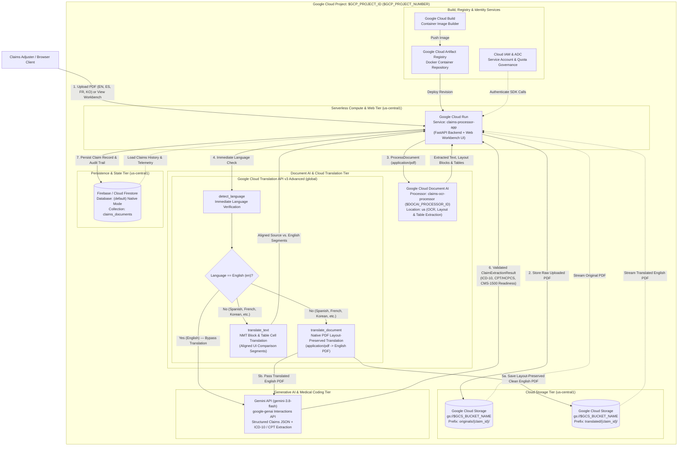
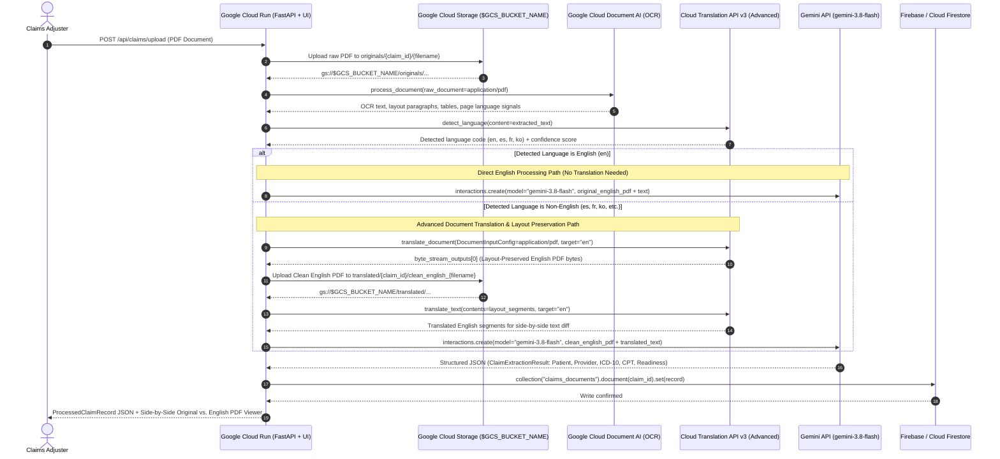
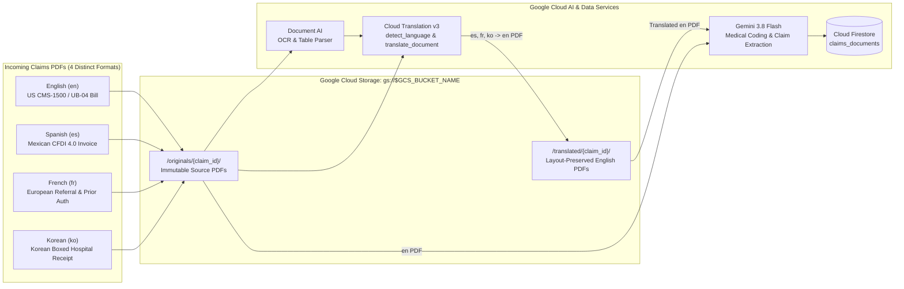

# Google Cloud Architecture — Healthcare Claims Document Processing & Translation Platform

**Configuration:** Loaded from `.env.gcp` (template: [`.env.gcp.example`](.env.gcp.example), protected by [`.gitignore`](.gitignore))  
**Primary Region:** `us-central1` (Document AI Multi-Region: `us`, Translation Location: `global`)  

---

## 1. Google Cloud Services Architecture Diagram

The diagram below illustrates how all Google Cloud Platform (GCP) and Firebase services in the configured project (`$GCP_PROJECT_ID`) work together to ingest, inspect, translate, compare, extract, and persist healthcare claims documents.

---

## 2. End-to-End Google Cloud Service Call Sequence

This sequence diagram details the runtime API interactions across Google Cloud services for every uploaded document, showing both the **Direct English Path** and the **Non-English Document Translation Path**.

---

## 3. Data & Storage Flow Across Google Cloud Services

---

## 4. Google Cloud Services Inventory & Implementation Mapping

| Google Cloud Service | Enabled API | Provisioned Resource / Configuration (via `.env.gcp`) | Role in Architecture | Backend Implementation |
| :--- | :--- | :--- | :--- | :--- |
| **Google Cloud Run** | `run.googleapis.com` | Service `$CLOUD_RUN_SERVICE` (`claims-processor-app`) in `$GCP_REGION` (`us-central1`) | Hosts the containerized FastAPI backend orchestrator and serves the interactive Claims Workbench & Side-by-Side PDF Comparator UI. | [`backend/main.py`](backend/main.py), [`Dockerfile`](Dockerfile) |
| **Google Cloud Storage** | `storage.googleapis.com` | Bucket `gs://${GCS_BUCKET_NAME}` (`us-central1`, `STANDARD`, UBLA, PAP Enforced, 7d Soft Delete, 2555d Lifecycle) | Stores immutable original uploaded PDFs (`originals/{claim_id}/`) and layout-preserved translated English PDFs (`translated/{claim_id}/`). | [`backend/services/storage_service.py`](backend/services/storage_service.py) |
| **Google Cloud Document AI** | `documentai.googleapis.com` | Processor `projects/${GCP_PROJECT_NUMBER}/locations/${DOCAI_LOCATION}/processors/${DOCAI_PROCESSOR_ID}` (`claims-ocr-processor`, `OCR_PROCESSOR`) | Extracts text, structural paragraphs, bounding layouts, tables, and page-level language signals from uploaded PDFs. | [`backend/services/document_ai_service.py`](backend/services/document_ai_service.py) |
| **Google Cloud Translation API v3 (Advanced)** | `translate.googleapis.com` | Parent `projects/${GCP_PROJECT_ID}/locations/global` (`detect_language`, `translate_document`, `translate_text`) | 1. Immediately detects document language. 2. Translates non-English PDFs in-place via `translate_document` while preserving visual layout. 3. Translates text blocks for aligned diff comparison. | [`backend/services/translation_service.py`](backend/services/translation_service.py) |
| **Gemini API (`google-genai`)** | `generativelanguage.googleapis.com`, `aiplatform.googleapis.com` | Model `gemini-3.8-flash` via `client.interactions.create` with strict JSON Schema | Performs multimodal extraction of patient/provider/payer fields, extracts or suggests `ICD-10-CM` and `CPT/HCPCS` codes, and computes CMS-1500 adjudication readiness. | [`backend/services/gemini_service.py`](backend/services/gemini_service.py) |
| **Firebase / Cloud Firestore** | `firestore.googleapis.com`, `firebaserules.googleapis.com` | Database `projects/${GCP_PROJECT_ID}/databases/(default)` (`us-central1`), collection `claims_documents` | Persists processed claims records, translation metadata, pipeline telemetry steps, and GCS document references. | [`backend/services/firestore_service.py`](backend/services/firestore_service.py), [`firestore.rules`](firestore.rules) |
| **Cloud Build & Artifact Registry** | `cloudbuild.googleapis.com`, `artifactregistry.googleapis.com` | Regional image build & container registry in `$GCP_REGION` (`us-central1`) | Builds the application container image and deploys immutable revisions to Cloud Run via `./deploy.sh --cloud-run`. | [`deploy.sh`](deploy.sh) |
| **Cloud IAM & Resource Manager** | `iam.googleapis.com`, `cloudresourcemanager.googleapis.com` | Project `$GCP_PROJECT_ID` (`$GCP_PROJECT_NUMBER`) ADC & Service Account bindings | Authenticates service-to-service API requests and enforces project quota attribution. | [`backend/config.py`](backend/config.py) |
